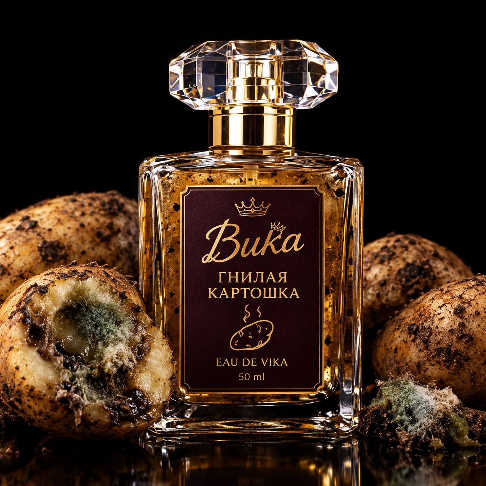

<!DOCTYPE html>
<html lang="ru">
<head>
  <meta charset="UTF-8">
  <meta name="viewport" content="width=device-width, initial-scale=1.0">
  <title>VIKUSI by K&K — Косметика и ароматы с характером</title>
  
  <!-- Tailwind CSS -->
  
  <!-- React & ReactDOM -->
  
  
  <!-- Babel for JSX -->
  
  <!-- Google Fonts -->
  <link rel="preconnect" href="https://fonts.googleapis.com">
  <link rel="preconnect" href="https://fonts.gstatic.com" crossorigin>
  <link href="https://fonts.googleapis.com/css2?family=Caveat:wght@600;700&family=Cormorant+Garamond:ital,wght@0,500;0,600;0,700;1,400&family=Montserrat:wght@300;400;500;600;700&display=swap" rel="stylesheet">

  
</head>
<body class="bg-brandMilk text-brandDark font-sans antialiased selection:bg-brandPink selection:text-brandBurgundy min-h-screen">

  

  
</body>
</html>
